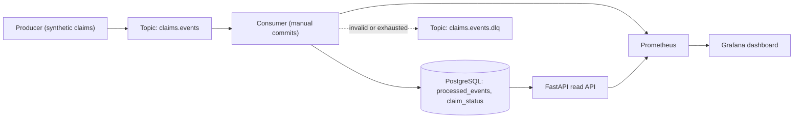
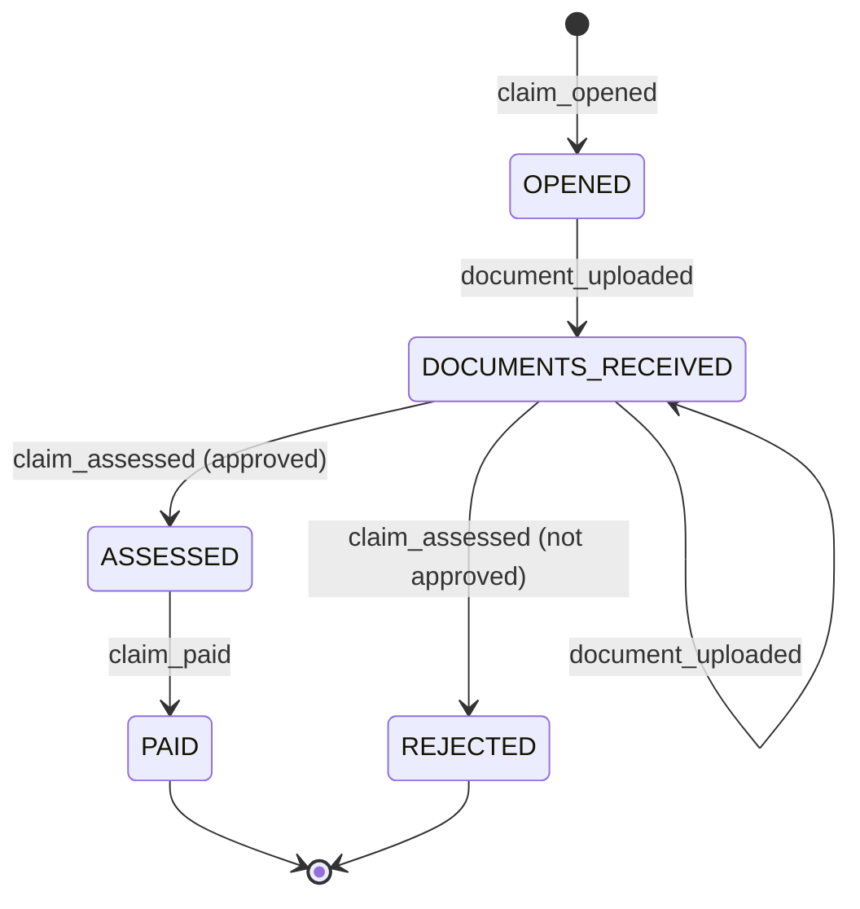

# realtime-claims-streaming

[](https://github.com/Beru47/realtime-claims-streaming/actions/workflows/ci.yml)


A small, runnable reference for **reliable event processing on Kafka**: insurance claim events flow from a
producer through Redpanda into PostgreSQL, where a state machine materializes the current status of every
claim. A FastAPI service reads the result, and Prometheus and Grafana show what the pipeline is doing.

This is a personal reference project. It runs on synthetic data and has not been used in production, so it
makes no throughput or latency claims. Its purpose is to show the engineering decisions around delivery
guarantees, idempotency, failure handling and observability, backed by tests that run against a real broker
and a real database in CI.

## Architecture



| Component | Role |
|---|---|
| `producer.py` | Generates claim lifecycles, keyed by `claim_id`. Can inject duplicates and bad events. |
| `schemas.py` | Pydantic event contract, versioned (v1 to v2), with upcasting at the edge. |
| `consumer.py` | Poll, process, commit loop with retries, backoff, DLQ and graceful shutdown. |
| `db.py` | One transaction per event: dedup, state transition, upsert. |
| `state_machine.py` | Pure transition table. Illegal transitions raise. |
| `api.py` | `GET /claims/{id}`, `GET /claims?status=`, `GET /health`, `/metrics`. |

## Delivery semantics

The pipeline is **at-least-once with idempotent processing**, which gives an effectively-once result in
PostgreSQL.

1. The consumer disables auto-commit. It commits an offset only after the message is fully handled: applied,
   recognized as a duplicate, or written to the dead-letter topic.
2. A crash, a restart or a rebalance between "written to Postgres" and "offset committed" redelivers the
   message. That is expected and safe, because every event carries a unique `event_id` and the sink inserts it
   into `processed_events` with `ON CONFLICT DO NOTHING`. If the insert does nothing, the event is a duplicate
   and is skipped.
3. The dedup row, the state check and the `claim_status` upsert happen in **one database transaction**. If the
   transition is illegal or the write fails, the dedup row rolls back too, so the event is never marked as
   processed without having been applied.

**Why not exactly-once?** Kafka transactions give exactly-once only inside Kafka (read-process-write between
topics). The side effect here is a write to an external database, and a Kafka transaction cannot make that
write atomic with the offset commit. To get exactly-once into Postgres you would have to store offsets in
Postgres and manage partition assignment yourself, which couples the sink to Kafka internals. The
at-least-once-plus-idempotency route needs only one unique key, stays correct when producers retry and
publish duplicates (which exactly-once consumption does not protect against), and makes replaying a topic
from the beginning a safe operation. The cost is one extra insert per event.

Ordering holds per claim, not globally: events are keyed by `claim_id`, so all events of one claim land in one
partition and are processed in order.

## The state machine



Anything not on this diagram is an `IllegalTransition`: paying a claim that was never assessed, paying twice,
uploading a document to a closed claim, opening the same claim twice. A schema-valid event that is illegal in
the current state is sent to the DLQ with reason `illegal_transition` and does not touch `claim_status`.

## Failure handling

| Situation | Behavior |
|---|---|
| Malformed JSON, failed validation, unknown `schema_version` | Published to `claims.events.dlq` (reason `invalid_event`), then committed. |
| Valid event, illegal transition | DLQ (reason `illegal_transition`), then committed. |
| Database unreachable (`OperationalError`) | Retried indefinitely with capped exponential backoff and jitter. The offset is not committed. The event is healthy, so it is not dead-lettered. |
| Other processing error (constraint violation, bad data) | Retried up to `MAX_ATTEMPTS`, then DLQ (reason `retries_exhausted`). |
| DLQ publish fails | The error propagates and the offset is **not** committed, so the message is redelivered rather than lost. |
| `SIGINT` / `SIGTERM` | The loop stops, an in-flight retry is abandoned without committing, and the consumer leaves the group cleanly. |
| Duplicate delivery | Skipped by the `event_id` dedup and counted in `claims_events_duplicates_total`. |

DLQ messages keep the original bytes and carry `dlq.reason`, `dlq.error` and `dlq.origin`
(`topic[partition]@offset`) headers, so they can be inspected and replayed after a fix.

## Run it

Requirements: Docker, Python 3.11+.

```bash
cp .env.example .env              # defaults already match docker-compose.yml
make install                      # pip install -e ".[dev]"
make up                           # Redpanda, PostgreSQL, Prometheus, Grafana

make consume                      # terminal 1: consumer, metrics on :8001
make api                          # terminal 2: API on :8000
make produce                      # terminal 3: 25 claims, with 5% bad and 10% duplicate events
```

```bash
curl localhost:8000/health
curl "localhost:8000/claims?status=PAID"
curl localhost:8000/claims/<claim_id>
```

- Grafana: http://localhost:3000 (read-only anonymous access, dashboard "Claims streaming" is provisioned).
- Prometheus: http://localhost:9090
- If a port is taken, override it: `POSTGRES_PORT=55432 GRAFANA_PORT=53000 make up`, and set `DATABASE_URL` to match.

Development:

```bash
make lint                # ruff check + ruff format --check
make test                # unit tests, no services needed
make test-integration    # needs `make up`; real Kafka + Postgres
```

## Metrics

Exposed by the consumer on `:8001/metrics` and scraped by Prometheus.

| Metric | Type | Meaning |
|---|---|---|
| `claims_events_consumed_total` | counter | Messages read from Kafka |
| `claims_events_applied_total` | counter | Events applied to `claim_status` |
| `claims_events_duplicates_total` | counter | Events skipped by dedup |
| `claims_events_failed_total{reason}` | counter | Failed attempts by `invalid_event`, `illegal_transition`, `infrastructure`, `processing_error` |
| `claims_events_dlq_total{reason}` | counter | Messages sent to the dead-letter topic |
| `claims_consumer_lag{partition}` | gauge | Log end offset minus committed offset |
| `claims_event_processing_seconds` | histogram | Per-message handling time, retries included |

The provisioned dashboard (`grafana/dashboards/claims.json`) shows throughput, lag per partition, p50/p95/p99
processing latency, failures and DLQ rate by reason.

## Tests

- **Unit** (`tests/unit`): schema validation and upcasting, every cell of the state-machine transition table,
  retry and backoff behavior, DLQ routing, graceful shutdown mid-retry, and full-stream replay idempotency.
- **Integration** (`tests/integration`): a real consumer thread against Redpanda and PostgreSQL, covering the
  end-to-end lifecycle plus the API, duplicate delivery, dead-lettering without blocking the stream, commit of
  every offset, and replaying the topic with a fresh consumer group.
- **CI** (`.github/workflows/ci.yml`): lint and unit tests, then integration tests against a Postgres service
  container and a Redpanda container. Redpanda is started with `docker run` because a `services:` container
  cannot receive the command-line arguments it needs.

## Project structure

```
src/claims/
  schemas.py        versioned Pydantic event contract
  state_machine.py  transition table, IllegalTransition
  db.py             schema, idempotent transactional upsert
  consumer.py       Processor (retry, DLQ) and ClaimsConsumer (poll, commit, lag)
  producer.py       synthetic event generator
  api.py            FastAPI read API
  metrics.py        Prometheus metric definitions
  topics.py         idempotent topic creation
  config.py         environment-based settings
tests/unit/         no services required
tests/integration/  real Kafka-compatible broker + PostgreSQL
grafana/            provisioned datasource and dashboard
prometheus/         scrape config
docker-compose.yml  Redpanda, PostgreSQL, Prometheus, Grafana
```

## Known limits

- The consumer commits after every message. Batching commits would raise throughput at the cost of more
  redelivery after a crash, which the idempotent sink already tolerates.
- One consumer instance is a single connection and a single thread. Scaling out means running more instances in
  the same group, up to the partition count.
- The API opens a connection per request, which is fine for a reference project.
- Events are trusted to be ordered per claim. A late `claim_opened` arriving after later events would be
  dead-lettered, not reordered.
- The dedup table grows without bound. A real deployment would partition it by time or expire old rows.

## Roadmap

- Avro with a Schema Registry and compatibility checks, replacing JSON plus Pydantic at the wire level.
- Kubernetes manifests with a Helm chart, consumer autoscaling on lag, and Prometheus alert rules.
- Apache Flink job for streaming aggregates (claims per status over time, payout windows) alongside the
  Postgres sink.
- Transactional outbox on the producing side.

## License

MIT
